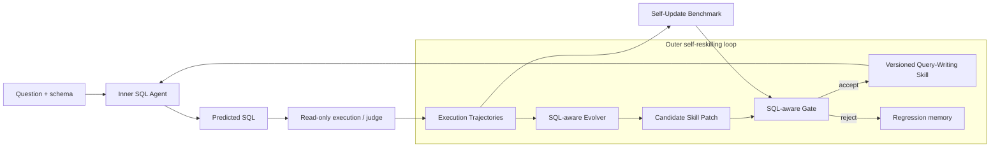

# ReskillSQL: A Self-Reskilling Text-to-SQL Agent

ReskillSQL is a SQL-aware, tool-aware Text-to-SQL agent that improves its external skills from SQL execution trajectories. It diagnoses why a generated query failed, produces a query-writing skill patch from the evidence, validates that patch with a SQL-aware gate, and promotes it as a versioned query-writing skill when the update is safe.

The project changes versioned skills and tool-use policies—not model weights—and keeps the update process inspectable through candidate diffs, validation reports, regression memory, and replay/live benchmarks.

**Quick links:** [Architecture](docs/ARCHITECTURE.md) · [Results](docs/EXPERIMENT_RESULTS.md) · [Benchmark Protocol](docs/BENCHMARK_PROTOCOL.md) · [Quickstart](docs/QUICKSTART.md) · [FAQ](docs/FAQ.md)

```text
question -> Inner SQL Agent -> execute/judge -> Execution Trajectories
         -> SQL-aware Evolver -> Candidate Skill Patch -> SQL-aware Gate
         -> Versioned Query-Writing Skill -> Inner SQL Agent
```

In short: the inner agent solves Text-to-SQL tasks; the outer evolver turns recurring execution failures into testable, versioned behavior updates.

## Results

The primary closed-loop result is a live old-skill vs new-skill run: the inner runner reads each skill and regenerates SQL from scratch on the same BIRD MiniDev slice. Replay results are reported as an auxiliary diagnostic for historical trajectories.

| Split | Before | After | Delta | Regressions | Improved Categories |
|---|---:|---:|---:|---:|---|
| Live BIRD 100 old-skill vs new-skill | 58/100 | 67/100 | +9.00% | 3 | ordering_limit, value_grounding, aggregation, projection, schema_linking |
| Generated transfer validation live | 78/149 | 81/149 | +2.01% | 9 | filtering, projection, value_grounding, schema_linking |
| Generated transfer holdout live | 75/150 | 82/150 | +4.67% | 7 | value_grounding, aggregation, projection |
| Update replay | 53/100 | 59/100 | +6.00% | 0 | projection, aggregation, value_grounding |
| Holdout replay | 20/50 | 22/50 | +4.00% | 0 | projection |
| 500-example BIRD replay collection | 232/500 | 257/500 | +5.00% | 6 | projection, value_grounding, schema_linking, ratio_numeric, aggregation, join_path |

Self-update transfer benchmark 2.0 now builds a 500-question category-conditioned benchmark from BIRD MiniDev:

| Benchmark Asset | Total | Gold SQL Validated | Update | Validation | Holdout |
|---|---:|---:|---:|---:|---:|
| Generated transfer 500 | 500 | 498/500 | 200 | 150 | 150 |

Self-update benchmark evaluates multi-round skill evolution, not only final SQL accuracy. The same 500 questions are also split into three category-balanced rounds:

| Round | Total | Update | Validation | Holdout | Validated |
|---|---:|---:|---:|---:|---:|
| round_1 | 170 | 68 | 50 | 52 | 170 |
| round_2 | 166 | 67 | 50 | 49 | 164 |
| round_3 | 164 | 65 | 50 | 49 | 164 |

Full three-round live evaluation over all validation/holdout rows: `174/300 -> 180/300` (`+2.00%`), failure avoidance rate `19.05%`, regressions `18`. Holdout improved in all three rounds.

The current live-safe skill is `skills/query-writing/versions/query-writing-v0010-live-safe.md`.

Lightweight replay ablation on the 100-example replay slice:

| Variant | Before | After | Delta | Regressions |
|---|---:|---:|---:|---:|
| no_reskill | 53/100 | 53/100 | +0.00% | 0 |
| query_skill_checks_only | 53/100 | 58/100 | +5.00% | 0 |
| value_lookup_only | 53/100 | 54/100 | +1.00% | 0 |
| full_system | 53/100 | 59/100 | +6.00% | 0 |

## Quick Demo

This demo is deterministic and does not call an LLM API. It shows how the current skill/tool policies rewrite recurring SQL failure patterns.

```bash
uv sync --extra dev
uv run text2sql-demo
uv run text2sql-render-report
```

Open `reports/showcase/index.html` for the static project report.

Example transformations:

| Failure Type | Before | After |
|---|---|---|
| Projection/result shape | `SELECT T2.category ...` | `SELECT DISTINCT T2.category ...` |
| Aggregation reasoning | `SELECT MAX(Consumption) ...` | `SELECT SUM(Consumption) ... GROUP BY month ORDER BY SUM(...) DESC LIMIT 1` |
| Value grounding | `expense_date = '2019-8-20'` | `expense_date = '2019-08-20'` |
| Ranking projection | `SELECT player_name, height ... ORDER BY height DESC LIMIT 1` | `SELECT player_name ... ORDER BY height DESC LIMIT 1` |

## Architecture

The inner loop generates and judges SQL. The outer loop reads the resulting execution trajectories, attributes failures, proposes a candidate patch, and lets the gate decide whether a new version should become active.



This makes the feedback path explicit: execution is evidence, the evolver proposes a bounded change, and the gate controls promotion back into the inner agent.

See [docs/ARCHITECTURE.md](docs/ARCHITECTURE.md) for the system diagram and runtime layers, [docs/EXPERIMENT_RESULTS.md](docs/EXPERIMENT_RESULTS.md) for experiment details, [docs/BENCHMARK_PROTOCOL.md](docs/BENCHMARK_PROTOCOL.md) for the update/validation/holdout protocol, [docs/METRICS.md](docs/METRICS.md) for metric definitions, [docs/CASE_STUDIES.md](docs/CASE_STUDIES.md) for representative fixes, and [docs/QUICKSTART.md](docs/QUICKSTART.md) for a compact setup guide.

Additional notes: [docs/FAQ.md](docs/FAQ.md), [docs/REPRODUCIBILITY.md](docs/REPRODUCIBILITY.md), [docs/KNOWN_LIMITATIONS.md](docs/KNOWN_LIMITATIONS.md), and [docs/INTERVIEW_GUIDE.zh.md](docs/INTERVIEW_GUIDE.zh.md).

Project maintenance files: [CHANGELOG.md](CHANGELOG.md), [CONTRIBUTING.md](CONTRIBUTING.md), [SECURITY.md](SECURITY.md), and [CITATION.cff](CITATION.cff).

## Project Structure

```text
text2sql_evolver/  # Runtime agent, failure analysis, patching, validation, memory, and benchmarks
skills/            # Current and versioned query-writing/schema-exploration skills
data/              # Local datasets and benchmark inputs; official/generated artifacts are not committed
docs/              # Architecture, protocol, results, reproducibility, and project guides
tests/             # Unit and integration tests for judging, policies, replay, and skill checks
reports/           # Generated JSON/Markdown/HTML experiment reports
```

The most important boundary is between `text2sql_evolver/` (the implementation) and `skills/` (the external behavior that can be proposed, validated, versioned, and promoted).

## Why Not Just Prompting?

ReskillSQL uses prompts, but the update mechanism is more constrained than changing a prompt until one example looks better:

- Skills have versions, so the active behavior and its history are explicit.
- A patch carries execution evidence and a target failure category.
- A SQL-aware gate checks the candidate before promotion, including improvement and regression signals.
- Regression memory preserves old-correct/new-wrong cases as protection examples for later updates.
- The self-update benchmark evaluates the update process and transfer to new examples, not only the final answer on the examples that caused the patch.

This does not claim that every update is safe or that replay replaces live evaluation. It provides a testable control loop around skill changes.

## Self-Update Benchmark

The self-update benchmark separates the data used to create an update from the data used to accept and assess it:

| Split | Role in the loop |
|---|---|
| `update` | Exposes recurring errors and supplies evidence for generating a candidate skill patch. |
| `validation` | Gives the SQL-aware gate a separate set for deciding whether to accept the candidate. |
| `holdout` | Remains unseen during patch creation and acceptance, then measures transfer to new tasks. |

There are two evaluation modes:

- **Replay** reuses stored trajectories and applies deterministic skill/tool policies. It is a cheaper diagnostic for debugging and broader historical slices.
- **Live** makes the model reread the old or new skill and regenerate SQL from scratch. It is the stronger check that the changed skill text affects model behavior.

The benchmark therefore asks two related questions: did the proposed skill update address the observed failure pattern, and does the accepted behavior transfer without excessive regressions? Existing results and their exact splits are listed in [docs/EXPERIMENT_RESULTS.md](docs/EXPERIMENT_RESULTS.md).

## Reproduce Results

Live old-skill vs new-skill comparison:

```bash
uv run text2sql-live-skill-compare \
  --dataset data/bird_minidev_full_001_100.jsonl \
  --before-skill skills/query-writing/versions/query-writing-v0002.md \
  --after-skill skills/query-writing/SKILL.md \
  --limit 100 \
  --output reports/live_skill_compare_bird100_v0002_vs_v0010_live_safe_20260712.json
```

The official BIRD data and generated reports are local artifacts and are not committed. After preparing BIRD MiniDev under `data/bird/`, the replay commands are:

```bash
uv run text2sql-evaluate-skill-replay \
  --dataset data/bird_minidev_full_001_100.jsonl \
  --examples reports/round-20260707-223959-413805/examples.json \
  --skill skills/query-writing/SKILL.md \
  --output reports/natural_replay_tool_aware_20260707_update_v3.json

uv run text2sql-evaluate-skill-replay \
  --dataset data/bird_minidev_full_101_150.jsonl \
  --examples reports/round-20260707-232414-683610/examples.json \
  --skill skills/query-writing/SKILL.md \
  --output reports/natural_replay_tool_aware_20260707_holdout_v4.json

uv run text2sql-summarize-replay-suite \
  --update reports/natural_replay_tool_aware_20260707_update_v3.json \
  --holdout reports/natural_replay_tool_aware_20260707_holdout_v4.json \
  --output reports/self_update_replay_suite_20260707.json

uv run text2sql-summarize-replay-collection \
  --result update_001_100=reports/natural_replay_tool_aware_20260707_update_v3.json \
  --result holdout_101_150=reports/natural_replay_tool_aware_20260707_holdout_v4.json \
  --result bird_151_250=reports/natural_replay_tool_aware_20260709_151_250.json \
  --result bird_251_300=reports/natural_replay_tool_aware_20260709_251_300.json \
  --result bird_301_400=reports/natural_replay_tool_aware_20260709_301_400.json \
  --result bird_401_500=reports/natural_replay_tool_aware_20260709_401_500.json \
  --output reports/self_update_replay_collection_500_20260709.json

uv run text2sql-replay-ablation \
  --dataset data/bird_minidev_full_001_100.jsonl \
  --examples reports/round-20260707-223959-413805/examples.json \
  --skill skills/query-writing/SKILL.md \
  --output reports/replay_ablation_bird100_20260712.json
```

Build the 500-question generated transfer benchmark:

```bash
uv run text2sql-make-generated-transfer-benchmark \
  --limit 500 \
  --output-dir data/self_update/generated_transfer_500
```

This writes `update.jsonl`, `validation.jsonl`, and `holdout.jsonl` under `data/self_update/generated_transfer_500/combined/`, plus per-category splits. It is designed to test whether a reskilled query-writing policy transfers to category-targeted challenges, rather than only repairing the examples that triggered the update.

Build the 3-round self-update benchmark:

```bash
uv run text2sql-make-multiround-self-update-benchmark \
  --source-dir data/self_update/generated_transfer_500 \
  --output-dir data/self_update/generated_transfer_500_multiround
```

Summarize multi-round live reports:

```bash
uv run text2sql-summarize-multiround-self-update \
  --benchmark-dir data/self_update/generated_transfer_500_multiround \
  --report reports/live_multiround_round_1_validation_v0002_vs_v0010_20260719.json \
  --report reports/live_multiround_round_1_holdout_v0002_vs_v0010_20260719.json \
  --report reports/live_multiround_round_2_validation_v0002_vs_v0010_20260719.json \
  --report reports/live_multiround_round_2_holdout_v0002_vs_v0010_20260719.json \
  --report reports/live_multiround_round_3_validation_v0002_vs_v0010_20260719.json \
  --report reports/live_multiround_round_3_holdout_v0002_vs_v0010_20260719.json \
  --skill skills/query-writing/SKILL.md \
  --output reports/multiround_self_update_full_live_summary_20260719.json
```

Run the generated transfer live checks:

```bash
uv run text2sql-live-skill-compare \
  --dataset data/self_update/generated_transfer_500/validated_only/validation.jsonl \
  --before-skill skills/query-writing/versions/query-writing-v0002.md \
  --after-skill skills/query-writing/SKILL.md \
  --output reports/live_generated_transfer_validation_149_v0002_vs_v0010_20260715.json

uv run text2sql-live-skill-compare \
  --dataset data/self_update/generated_transfer_500/validated_only/holdout.jsonl \
  --before-skill skills/query-writing/versions/query-writing-v0002.md \
  --after-skill skills/query-writing/SKILL.md \
  --output reports/live_generated_transfer_holdout_150_v0002_vs_v0010_20260715.json
```

Prepare BIRD JSONL:

```bash
uv run text2sql-prepare-bird \
  --input data/bird/raw/minidev/minidev/MINIDEV/mini_dev_sqlite.json \
  --bird-root data/bird/raw/minidev/minidev/MINIDEV \
  --output data/bird_minidev_full_cli.jsonl
```

## Core Commands

```bash
# API-free deterministic demo
uv run text2sql-demo

# Static HTML showcase report
uv run text2sql-render-report

# One live evolver round
uv run text2sql-evolve --dataset data/chinook_eval.jsonl --limit 5

# Live old-skill vs new-skill comparison
uv run text2sql-live-skill-compare --dataset <data.jsonl> --before-skill <old.md> --after-skill <new.md>

# Replay a historical run through current skill/tool policies
uv run text2sql-evaluate-skill-replay --dataset <data.jsonl> --examples <examples.json>

# Summarize update + holdout replay
uv run text2sql-summarize-replay-suite --update <update.json> --holdout <holdout.json>

# Summarize any number of replay slices
uv run text2sql-summarize-replay-collection --result split_a=<a.json> --result split_b=<b.json>

# Build generated transfer benchmark splits
uv run text2sql-make-generated-transfer-benchmark --limit 500

# Build 3-round self-update benchmark splits
uv run text2sql-make-multiround-self-update-benchmark

# Summarize multi-round self-update metrics
uv run text2sql-summarize-multiround-self-update --report <live-a.json> --report <live-b.json>

# Tests
uv run pytest -q
```

## Repository Map

```text
self-evolving-text2sql/
├── agent.py                         # DeepAgents baseline CLI
├── skills/
│   ├── query-writing/SKILL.md        # current reskilled SQL behavior
│   └── schema-exploration/SKILL.md   # schema exploration skill
├── text2sql_evolver/
│   ├── core/                         # outer evolution orchestration
│   ├── runners/                      # LLM and cached runners
│   ├── analyzers/                    # SQL failure attribution
│   ├── tools/                        # value lookup and schema context policies
│   ├── editors/                      # skill patch generation and aggregation
│   ├── validators/                   # gate, rollback, acceptance
│   ├── benchmarks/                   # BIRD and self-update replay CLIs
│   ├── memory/                       # history, versions, rejected patches
│   └── reports/                      # JSON/Markdown report writers
├── docs/
│   ├── ARCHITECTURE.md               # system and reskill flow diagrams
│   ├── EXPERIMENT_RESULTS.md         # update/holdout replay results
│   ├── CASE_STUDIES.md               # concrete before/after SQL cases
│   ├── QUICKSTART.md                  # setup and reproduction guide
│   └── SYSTEM_WALKTHROUGH.md         # code-level walkthrough
└── tests/                            # judge, tool policy, replay, skill checks
```

## Resume Pitch

Built a SQL-aware and tool-aware self-reskilling Text-to-SQL agent that diagnoses execution failures, routes them to query-writing or tool-use policy updates, and validates candidate skills with live and replay evaluation. Implemented value lookup, runtime skill compilation, conservative SQL repair retry, SQLite timeout-safe judge, skill versioning, rejected patch memory, SQL-aware gate, and BIRD tooling; improved a live BIRD MiniDev slice from 58% to 67% execution accuracy and a 500-example replay collection from 46.4% to 51.4%.

Built a 500-question generated self-update transfer benchmark with update/validation/holdout splits and 498/500 executable gold SQL; on validated live transfer checks, the reskilled agent improved validation accuracy from 52.35% to 54.36% and holdout accuracy from 50.00% to 54.67%.

Added regression memory over the generated transfer runs: 16 old-correct/new-wrong cases are persisted as future protection examples for stricter self-update gates.

## Limitations

- The live result is currently a 100-example slice; larger live reruns are slower because they require two model calls per example.
- The 500-example replay is broader, but replay should not be reported as a full live BIRD benchmark score.
- One replay slice regressed from 78% to 74%, so tool policies still need stricter promotion gates for high-baseline slices.
- Value lookup is intentionally conservative to avoid regressions; it mainly fixes high-confidence literal formatting and stored-value normalization.
- This project does not update model weights. It updates external skills, tool-use policies, and compiled checks.

## Safety

The judge only executes read-only `SELECT` / `WITH ... SELECT` SQL, blocks write/admin statements, opens SQLite with `PRAGMA query_only = ON`, and interrupts slow queries with a progress-handler timeout.
