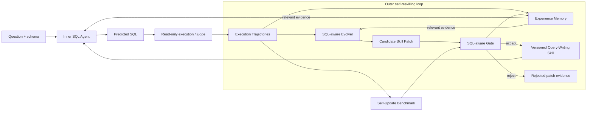

# ReskillSQL: A Self-Reskilling Text-to-SQL Agent

ReskillSQL is a SQL-aware, tool-aware Text-to-SQL agent that improves its external skills from SQL execution trajectories. It diagnoses why a generated query failed, produces a query-writing skill patch from the evidence, validates that patch with a SQL-aware gate, and promotes it as a versioned query-writing skill when the gate accepts the update.

The project changes versioned skills and tool-use policies—not model weights—and keeps the update process inspectable through candidate diffs, validation reports, regression memory, and replay/live benchmarks.

**Quick links:** [Architecture](docs/ARCHITECTURE.md) · [Experience Memory](docs/MEMORY.md) · [Benchmark Protocol](docs/BENCHMARK_PROTOCOL.md) · [Quickstart](docs/QUICKSTART.md) · [FAQ](docs/FAQ.md)

**Serving and background learning:** the optional [single-host runtime](docs/DEPLOYMENT.md) provides an authenticated job API, durable queues with fenced leases, isolated evolution workspaces, and atomic Skill/Memory releases with rollback. Queries pin a read-only release; learning runs in separate worker processes and publishes only after development checks. This is a deployment implementation and runbook, not a claim that a public service has been deployed or load-tested.

中文说明：[在线查询、后台队列与版本发布](docs/DEPLOYMENT.zh.md)。

Optional MemRL-style experience memory is available for the evolver: it persists SQL attempts and rejected-Skill validation evidence, retrieves by semantic relevance and learned utility, and updates memory values from task feedback. The integration reuses a pinned, MIT-licensed subset of MemRL and records its exact provenance. See [Experience Memory](docs/MEMORY.md) or the [Chinese implementation notes](docs/MEMRL_MEMORY.zh.md). Memory is off by default.

```text
question -> Inner SQL Agent -> execute/judge -> Execution Trajectories
         -> SQL-aware Evolver -> Candidate Skill Patch -> SQL-aware Gate
         -> Versioned Query-Writing Skill -> Inner SQL Agent
```

In short: the inner agent solves Text-to-SQL tasks; the outer evolver turns recurring execution failures into testable, versioned behavior updates.

## Evaluation Status

This repository publishes the implementation, benchmark builders, evaluation runners, configuration, and tests. It does not publish an official accuracy table or commit provider-specific result artifacts. Generated reports remain local under `reports/` and are ignored by Git, following the same code-first release pattern used by MemRL.

The planned primary evaluation uses a fixed Gemini 2.5 Flash backbone on a BIRD-derived self-update benchmark. It separates `update`, `validation`, and frozen `holdout` data and compares Skill updating and experience memory in a 2×2 design. Results will be reported only after the benchmark, code revision, model configuration, and evaluation protocol are frozen.

## Quick Demo

This demo is deterministic and does not call an LLM API. It shows how the current skill/tool policies rewrite recurring SQL failure patterns.

```bash
uv sync --extra dev
uv run text2sql-demo
uv run text2sql-render-report
```

Open `reports/showcase/index.html` for the static project report.

Example transformations:

| Failure Type | Before | After |
|---|---|---|
| Projection/result shape | `SELECT T2.category ...` | `SELECT DISTINCT T2.category ...` |
| Aggregation reasoning | `SELECT MAX(Consumption) ...` | `SELECT SUM(Consumption) ... GROUP BY month ORDER BY SUM(...) DESC LIMIT 1` |
| Value grounding | `expense_date = '2019-8-20'` | `expense_date = '2019-08-20'` |
| Ranking projection | `SELECT player_name, height ... ORDER BY height DESC LIMIT 1` | `SELECT player_name ... ORDER BY height DESC LIMIT 1` |

## Why It Is Different

- **SQL-aware attribution**: failures are localized to projection, result shape, aggregation, ordering, ratio/numeric, value grounding, schema linking, join path, filtering, or runtime behavior.
- **Fix-route decisions**: the system separates `query_skill`, `value_lookup_tool`, `schema_context`, `inner_repair`, and `uncertain` instead of forcing every failure into one prompt.
- **Tool-aware reskilling**: the agent learns when to use value lookup and schema context policies, not just how to phrase SQL instructions.
- **Gate and rollback discipline**: candidate skills are evaluated with before/after accuracy, target category movement, regression checks, patch budget, versioning, and rejected-patch memory.
- **Regression evidence**: old-correct/new-wrong examples are recorded for diagnosis and future protection experiments; the legacy records are not automatically imported into every promotion gate.
- **Execution safety**: SQLite is executed read-only with timeout protection so bad model SQL cannot hang the benchmark.
- **Experience memory**: optional SQL episodes and Skill-validation outcomes are persisted, retrieved by semantic similarity and learned utility, and updated only after a frozen evaluation round.

## Experience Memory

Memory augments the outer reskilling loop without changing model weights. A memory entry keeps its source intent, a reusable experience summary, structured provenance, and utility estimates. The current implementation uses the following lifecycle:

1. Retrieve candidates from the same database and schema scope by embedding similarity.
2. Select a bounded context with MemRL's value-aware selector.
3. Inject only the selected evidence into SQL generation or Skill optimization.
4. Finish the task or candidate-Skill validation before writing new experience.
5. Update the utility of memories that were actually injected, using task or gate feedback.

Both accepted and rejected Skill candidates may produce evidence. A rejected patch is stored as a failed generalization attempt, while an individual validation case may still be retained as a local improvement or counterexample. Historical failures are evidence, not executable instructions.

The implementation enforces source-ID exclusion, update/validation-only learning, read-only final evaluation, schema-scoped retrieval, idempotent feedback events, and separate inference/optimizer utility contexts. It does not claim exact reproduction of the MemRL paper: this project reuses the upstream Q-first selector after cosine recall rather than the paper's normalized similarity/Q mixture.

```bash
# Required only when memory is enabled. Use an embeddings-compatible endpoint.
export TEXT2SQL_MEMORY_EMBEDDING_MODEL='<embedding-model>'
export TEXT2SQL_MEMORY_EMBEDDING_BASE_URL='<embedding-endpoint>'
export TEXT2SQL_MEMORY_EMBEDDING_API_KEY='<embedding-key>'

# Learn from update and validation data.
uv run text2sql-evolve \
  --dataset data/update.jsonl \
  --validation-dataset data/validation.jsonl \
  --dataset-role update \
  --memory-mode learn \
  --memory-build proceduralization

# Freeze memory during final evaluation.
uv run text2sql-live-skill-compare \
  --dataset data/final_holdout.jsonl \
  --before-skill skills/query-writing/versions/query-writing-v0002.md \
  --after-skill skills/query-writing/SKILL.md \
  --memory-mode read
```

Memory databases, raw provider logs, and API credentials are local artifacts and are not committed. See [docs/MEMORY.md](docs/MEMORY.md) for configuration, provenance, isolation guarantees, and current limitations.

## Architecture

The inner loop generates and judges SQL. The outer loop reads the resulting execution trajectories, attributes failures, proposes a candidate patch, and lets the gate decide whether a new version should become active. Optional experience memory supports both loops without modifying model weights.



This makes the feedback path explicit: execution is evidence, the evolver proposes a bounded change, and the gate controls promotion back into the inner agent.

See [docs/ARCHITECTURE.md](docs/ARCHITECTURE.md) for the system diagram and runtime layers, [docs/BENCHMARK_PROTOCOL.md](docs/BENCHMARK_PROTOCOL.md) for the update/validation/holdout protocol, [docs/METRICS.md](docs/METRICS.md) for metric definitions, [docs/CASE_STUDIES.md](docs/CASE_STUDIES.md) for representative fixes, and [docs/QUICKSTART.md](docs/QUICKSTART.md) for a compact setup guide.

Additional notes: [docs/FAQ.md](docs/FAQ.md), [docs/REPRODUCIBILITY.md](docs/REPRODUCIBILITY.md), [docs/KNOWN_LIMITATIONS.md](docs/KNOWN_LIMITATIONS.md), and [docs/INTERVIEW_GUIDE.zh.md](docs/INTERVIEW_GUIDE.zh.md).

Project maintenance files: [CHANGELOG.md](CHANGELOG.md), [CONTRIBUTING.md](CONTRIBUTING.md), [SECURITY.md](SECURITY.md), and [CITATION.cff](CITATION.cff).

## Project Structure

```text
text2sql_evolver/  # Runtime agent, failure analysis, patching, validation, memory, and benchmarks
skills/            # Current and versioned query-writing/schema-exploration skills
data/              # Local datasets and benchmark inputs; official/generated artifacts are not committed
docs/              # Architecture, protocol, reproducibility, and project guides
tests/             # Unit and integration tests for judging, policies, replay, and skill checks
reports/           # Generated JSON/Markdown/HTML experiment reports
```

The most important boundary is between `text2sql_evolver/` (the implementation) and `skills/` (the external behavior that can be proposed, validated, versioned, and promoted).

## Why Not Just Prompting?

ReskillSQL uses prompts, but the update mechanism is more constrained than changing a prompt until one example looks better:

- Skills have versions, so the active behavior and its history are explicit.
- A patch carries execution evidence and a target failure category.
- A SQL-aware gate checks the candidate before promotion, including improvement and regression signals.
- Regression evidence preserves old-correct/new-wrong cases for diagnosis and future protection experiments.
- The self-update benchmark evaluates the update process and transfer to new examples, not only the final answer on the examples that caused the patch.

This does not claim that every update is safe or that replay replaces live evaluation. It provides a testable control loop around skill changes.

## Self-Update Benchmark

The self-update benchmark separates the data used to create an update from the data used to accept and assess it:

| Split | Role in the loop |
|---|---|
| `update` | Exposes recurring errors and supplies evidence for generating a candidate skill patch. |
| `validation` | Gives the SQL-aware gate a separate set for deciding whether to accept the candidate. |
| `holdout` | Remains unseen during patch creation and acceptance, then measures transfer to new tasks. |

There are two evaluation modes:

- **Replay** reuses stored trajectories and applies deterministic skill/tool policies. It is a cheaper diagnostic for debugging and broader historical slices.
- **Live** makes the model reread the old or new skill and regenerate SQL from scratch. It is the stronger check that the changed skill text affects model behavior.

The benchmark therefore asks two related questions: did the proposed Skill update address the observed failure pattern, and does the accepted behavior transfer without excessive regressions? The protocol is defined before any final holdout result is inspected.

## Running Benchmarks

Live old-Skill vs new-Skill comparison generates a local report:

```bash
uv run text2sql-live-skill-compare \
  --dataset data/bird_minidev_full_001_100.jsonl \
  --before-skill skills/query-writing/versions/query-writing-v0002.md \
  --after-skill skills/query-writing/SKILL.md \
  --limit 100 \
  --output reports/live_skill_compare.json
```

The official BIRD data and generated reports are local artifacts and are not committed. After preparing BIRD data under `data/bird/`, the replay commands are:

```bash
uv run text2sql-evaluate-skill-replay \
  --dataset data/bird_minidev_full_001_100.jsonl \
  --examples reports/round-20260707-223959-413805/examples.json \
  --skill skills/query-writing/SKILL.md \
  --output reports/natural_replay_tool_aware_20260707_update_v3.json

uv run text2sql-evaluate-skill-replay \
  --dataset data/bird_minidev_full_101_150.jsonl \
  --examples reports/round-20260707-232414-683610/examples.json \
  --skill skills/query-writing/SKILL.md \
  --output reports/natural_replay_tool_aware_20260707_holdout_v4.json

uv run text2sql-summarize-replay-suite \
  --update reports/natural_replay_tool_aware_20260707_update_v3.json \
  --holdout reports/natural_replay_tool_aware_20260707_holdout_v4.json \
  --output reports/self_update_replay_suite_20260707.json

uv run text2sql-summarize-replay-collection \
  --result update_001_100=reports/natural_replay_tool_aware_20260707_update_v3.json \
  --result holdout_101_150=reports/natural_replay_tool_aware_20260707_holdout_v4.json \
  --result bird_151_250=reports/natural_replay_tool_aware_20260709_151_250.json \
  --result bird_251_300=reports/natural_replay_tool_aware_20260709_251_300.json \
  --result bird_301_400=reports/natural_replay_tool_aware_20260709_301_400.json \
  --result bird_401_500=reports/natural_replay_tool_aware_20260709_401_500.json \
  --output reports/self_update_replay_collection_500_20260709.json

uv run text2sql-replay-ablation \
  --dataset data/bird_minidev_full_001_100.jsonl \
  --examples reports/round-20260707-223959-413805/examples.json \
  --skill skills/query-writing/SKILL.md \
  --output reports/replay_ablation_bird100_20260712.json
```

Build the 500-question generated transfer benchmark:

```bash
uv run text2sql-make-generated-transfer-benchmark \
  --limit 500 \
  --output-dir data/self_update/generated_transfer_500
```

This writes `update.jsonl`, `validation.jsonl`, and `holdout.jsonl` under `data/self_update/generated_transfer_500/combined/`, plus per-category splits. It is designed to test whether a reskilled query-writing policy transfers to category-targeted challenges, rather than only repairing the examples that triggered the update.

Build the 3-round self-update benchmark:

```bash
uv run text2sql-make-multiround-self-update-benchmark \
  --source-dir data/self_update/generated_transfer_500 \
  --output-dir data/self_update/generated_transfer_500_multiround
```

Summarize multi-round live reports:

```bash
uv run text2sql-summarize-multiround-self-update \
  --benchmark-dir data/self_update/generated_transfer_500_multiround \
  --report reports/live_multiround_round_1_validation_v0002_vs_v0010_20260719.json \
  --report reports/live_multiround_round_1_holdout_v0002_vs_v0010_20260719.json \
  --report reports/live_multiround_round_2_validation_v0002_vs_v0010_20260719.json \
  --report reports/live_multiround_round_2_holdout_v0002_vs_v0010_20260719.json \
  --report reports/live_multiround_round_3_validation_v0002_vs_v0010_20260719.json \
  --report reports/live_multiround_round_3_holdout_v0002_vs_v0010_20260719.json \
  --skill skills/query-writing/SKILL.md \
  --output reports/multiround_self_update_full_live_summary_20260719.json
```

Run the generated transfer live checks:

```bash
uv run text2sql-live-skill-compare \
  --dataset data/self_update/generated_transfer_500/validated_only/validation.jsonl \
  --before-skill skills/query-writing/versions/query-writing-v0002.md \
  --after-skill skills/query-writing/SKILL.md \
  --output reports/live_generated_transfer_validation_149_v0002_vs_v0010_20260715.json

uv run text2sql-live-skill-compare \
  --dataset data/self_update/generated_transfer_500/validated_only/holdout.jsonl \
  --before-skill skills/query-writing/versions/query-writing-v0002.md \
  --after-skill skills/query-writing/SKILL.md \
  --output reports/live_generated_transfer_holdout_150_v0002_vs_v0010_20260715.json
```

Prepare BIRD JSONL:

```bash
uv run text2sql-prepare-bird \
  --input data/bird/raw/minidev/minidev/MINIDEV/mini_dev_sqlite.json \
  --bird-root data/bird/raw/minidev/minidev/MINIDEV \
  --output data/bird_minidev_full_cli.jsonl
```

## Core Commands

```bash
# API-free deterministic demo
uv run text2sql-demo

# Static HTML showcase report
uv run text2sql-render-report

# One live evolver round
uv run text2sql-evolve --dataset data/chinook_eval.jsonl --limit 5

# Live old-skill vs new-skill comparison
uv run text2sql-live-skill-compare --dataset <data.jsonl> --before-skill <old.md> --after-skill <new.md>

# Replay a historical run through current skill/tool policies
uv run text2sql-evaluate-skill-replay --dataset <data.jsonl> --examples <examples.json>

# Summarize update + holdout replay
uv run text2sql-summarize-replay-suite --update <update.json> --holdout <holdout.json>

# Summarize any number of replay slices
uv run text2sql-summarize-replay-collection --result split_a=<a.json> --result split_b=<b.json>

# Build generated transfer benchmark splits
uv run text2sql-make-generated-transfer-benchmark --limit 500

# Build 3-round self-update benchmark splits
uv run text2sql-make-multiround-self-update-benchmark

# Summarize multi-round self-update metrics
uv run text2sql-summarize-multiround-self-update --report <live-a.json> --report <live-b.json>

# Tests
uv run pytest -q
```

## Repository Map

```text
self-evolving-text2sql/
├── agent.py                         # DeepAgents baseline CLI
├── skills/
│   ├── query-writing/SKILL.md        # current reskilled SQL behavior
│   └── schema-exploration/SKILL.md   # schema exploration skill
├── text2sql_evolver/
│   ├── core/                         # outer evolution orchestration
│   ├── runners/                      # LLM and cached runners
│   ├── analyzers/                    # SQL failure attribution
│   ├── tools/                        # value lookup and schema context policies
│   ├── editors/                      # skill patch generation and aggregation
│   ├── validators/                   # gate, rollback, acceptance
│   ├── benchmarks/                   # BIRD and self-update replay CLIs
│   ├── memory/                       # history, versions, rejected patches
│   └── reports/                      # JSON/Markdown report writers
├── docs/
│   ├── ARCHITECTURE.md               # system and reskill flow diagrams
│   ├── MEMORY.md                     # experience-memory design and isolation
│   ├── CASE_STUDIES.md               # concrete before/after SQL cases
│   ├── QUICKSTART.md                  # setup and reproduction guide
│   └── SYSTEM_WALKTHROUGH.md         # code-level walkthrough
└── tests/                            # judge, tool policy, replay, skill checks
```

## Limitations

- Provider-backed evaluation is intentionally not published in the repository at this stage.
- Replay is a diagnostic mode and should not be reported as equivalent to fresh live generation.
- The BIRD-derived self-update benchmark is under active development and is not an official BIRD leaderboard split.
- Value lookup is intentionally conservative to avoid regressions; it mainly fixes high-confidence literal formatting and stored-value normalization.
- This project does not update model weights. It updates external skills, tool-use policies, and compiled checks.

## Safety

The judge only executes read-only `SELECT` / `WITH ... SELECT` SQL, blocks write/admin statements, opens SQLite with `PRAGMA query_only = ON`, and interrupts slow queries with a progress-handler timeout.
