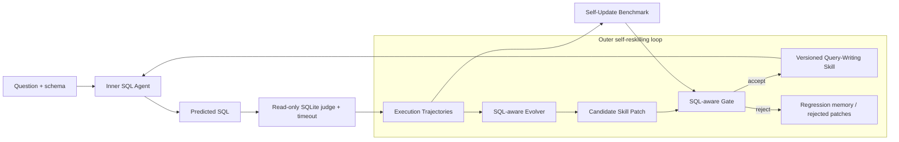
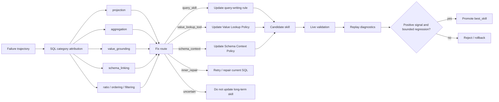

# Architecture

## System Overview

The system has two coupled loops. The inner agent generates and executes SQL for a task. The outer evolver treats the resulting execution trajectories as evidence, proposes a bounded skill change, and promotes it only when the SQL-aware gate accepts the candidate.

The benchmark is part of the control loop: `update` supplies failure evidence, `validation` informs promotion, and `holdout` checks transfer after acceptance. The implementation also applies compiled skill checks and tool policies between SQL generation and judging.

## Reskill Flow

## Runtime Layers

| Layer | Files | Responsibility |
|---|---|---|
| Inner runner | `text2sql_evolver/inner_runner.py`, `runners/` | Prompt model, read skill, apply compiled checks and tool policies |
| Judge | `text2sql_evolver/judge.py` | Read-only execution, result comparison, timeout protection |
| Analyzer | `text2sql_evolver/sql_analyzer.py`, `analyzers/` | SQL-aware failure category and detector evidence |
| Tool policies | `text2sql_evolver/tools/` | Value lookup and schema context behaviors controlled by skill policy |
| Evolver | `text2sql_evolver/core/orchestrator.py` | Failure store, route diagnosis, patch generation, validation, reporting |
| Skill memory | `skills/query-writing/`, `text2sql_evolver/memory/` | Candidate skill, best skill, version history, rejected patches |
| Benchmark | `text2sql_evolver/benchmarks/` | BIRD adapters, replay evaluation, update/holdout suite summary |

## Current Self-Update Suite

| Split | Before | After | Delta | Regressions |
|---|---:|---:|---:|---:|
| Live BIRD 100 old-skill vs new-skill | 58/100 | 67/100 | +9.00% | 3 |
| Update replay | 53/100 | 59/100 | +6.00% | 0 |
| Holdout replay | 20/50 | 22/50 | +4.00% | 0 |
| 500-example replay collection | 232/500 | 257/500 | +5.00% | 6 |

Improved categories in the 500-example collection: `projection`, `aggregation`, `value_grounding`, `schema_linking`, `join_path`, `ratio_numeric`.
